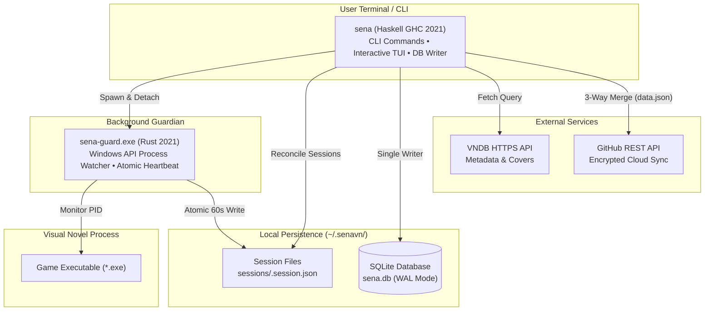

<!-- markdownlint-disable MD013 MD033 MD041 -->

<div align="center">

# SenaVN | GalKeeper 2.0

**A terminal-first Visual Novel library manager, gameplay tracker, and GitHub cloud synchronizer.**

Crafted for keyboard-driven players and programmers — pure terminal, zero GUI overhead, native Windows process tracking.

[](LICENSE)
[](https://github.com/biyuehu/vn-cli/actions/workflows/ci.yml)


</div>

---

## Architecture

SenaVN operates as two cooperative binaries without FFI complexity:



- **`sena` (Haskell)**: CLI interface, interactive Brick TUI, SQLite operations, VNDB API queries, and 3-way cloud sync.
- **`sena-guard` (Rust)**: Standalone lightweight daemon for low-level Windows process polling. Completely independent from SQLite, ensuring zero database lock contention.

---

## Features

- **🎮 Dual Mode Interface**: Run `sena` without arguments to enter the full-screen interactive **TUI browser** (powered by Brick), or use rich CLI subcommands for instant shell scripting and automation.
- **🔍 Seamless VNDB Integration**: Search visual novels directly by name or ID, interactively select search results, and review/edit metadata inside your preferred `$EDITOR` before saving.
- **⏱️ Automated Gameplay Tracking**: Non-blocking game launch. `sena-guard` tracks process lifecycles in the background, continuously writing atomic heartbeats.
- **🛡️ Crash-Resilient Reconcile**: Unscheduled system reboots or game crashes are automatically reconciled and backfilled on the next CLI run — no lost play sessions.
- **☁️ 3-Way Cloud Synchronization**: Synchronize your library with a private GitHub repository. Includes Last-Write-Wins (LWW) conflict resolution, session deduplication, and resurrection of modified games.
- **⚰️ Two-Tier Deletion & Tombstone Tracking**:
  - `sena rm <id>`: Soft removal from local library without deleting remote cloud assets.
  - `sena rm <id> -H`: Permanent deletion recording an atomic tombstone in `deleted_games`, propagating cloud-wide on sync.
  - Reusing a previously deleted ID in `sena add` or `sena mv` safely clears historical tombstones with user confirmation.
- **📈 Git-Log Style Timelines & Statistics**: Visualize your visual novel journey with flowing session graphs, date grouping, total play duration calculations, and top-played rankings.
- **🪟 Native Windows Terminal Adaptation**: Automatic UTF-8 (`CP65001`) console output switching without needing manual `chcp`, with full support for ANSI styling and color themes.

---

## Tech Stack

| Component | Technologies |
| :--- | :--- |
| **CLI & TUI Engine** | Haskell (GHC 2021, Base 4.19), [Brick 2.12](https://github.com/jtdaugherty/brick), [Vty](https://github.com/jtdaugherty/vty), [optparse-applicative](https://github.com/pcapriotti/optparse-applicative) |
| **Process Guardian** | Rust 2021, `sysinfo`, `winapi` (Windows User32 / Kernel32) |
| **Database & Cache** | SQLite 3 (`sqlite-simple` with WAL journal mode, busy timeouts, and cascading foreign keys) |
| **Network & Sync** | [Req](https://github.com/mrkkrp/req) (HTTP/HTTPS client), Aeson (JSON serialization), RFC 4648 Base64 |
| **Testing & CI** | Self-contained zero-dependency Haskell test suite (51 test cases), GitHub Actions CI |

---

## CLI Reference

```sh
sena                                # Launch full-screen interactive TUI browser
sena add <name> <id> [path]         # Add a game from VNDB with interactive picker & editor
sena edit <id>                      # Edit game metadata in $EDITOR (or --fetch to refresh)
sena run <id>                       # Launch game and start background tracking
sena run --random                   # Pick a random game from library and launch
sena run --recent | --last          # Launch most recently played game
sena status                         # Display currently running games and active playtime
sena list [-s <field>] [-r] [-d]    # List games (sort by played/rating/release/date, detail mode)
sena stat [id...]                   # Library-wide aggregate statistics or per-game stats
sena tl [id...] [--today] [--oneline] # Git-log style gameplay session timeline
sena use <id> <exe> [--save <p>]    # Link local executable path, save directory, and walkthrough
sena info <id> [-g] [-s]            # View game card or quickly open guide file / save directory
sena mv <old-id> <new-id>           # Rename game ID (auto-migrates sessions and cloud tombstones)
sena rm <id> [-H, --hard]           # Remove game (soft local removal or -H permanent cloud deletion)
sena sync [--dry-run]               # Bidirectional 3-way cloud sync with GitHub repository
sena config [key] [val] [-u] [-e]   # View, set, unset, or edit configuration in $EDITOR
sena completion <shell>             # Generate completion script (bash, zsh, fish, powershell)
```

### Configuration Keys

Configure via `sena config <key> <val>` or `sena config -e`:

| Key | Description | Default |
| :--- | :--- | :--- |
| `core.editor` | Preferred editor command (e.g. `code --wait`, `nvim`, `notepad`) | Fallback to `$VISUAL` / `$EDITOR` |
| `fetch.proxy` | HTTP/HTTPS proxy for VNDB queries and GitHub sync | `""` |
| `sync.repo` | Target GitHub repository in `owner/repo` format | `""` |
| `sync.token` | GitHub Personal Access Token with repository scope | `""` (Masked in output) |
| `sync.branch` | Target branch for synchronization data | `main` |
| `sync.path` | File path in repository storing synchronized library data | `data.json` |

---

## Build & Development

### Prerequisites

- **GHC 9.8.2** & **Cabal 3.10+** (via [GHCup](https://www.haskell.org/ghcup/))
- **Rust Stable** (via [rustup](https://rustup.rs/))
- **Just** task runner (optional, recommended: `cargo install just`)

### Build Commands

```sh
# One-step build: compiles both Rust and Haskell, and syncs sena-guard.exe
just build

# Or manually:
cargo build --release
cabal build
copy target\release\sena-guard.exe (dist-newstyle\..\SenaVN.exe directory)

# Run full test suite (51 unit tests)
cabal test

# Check code formatting & compiler warnings
cargo clippy --all-targets -- -D warnings
cabal build --enable-tests --ghc-options="-Werror"
```

---

## About

`Sena` is named after **姬野星奏 (Himeno Sena)**, the heroine from the visual novel [*恋×シンアイ彼女 (Koi x Shin Ai Kanojo)*](https://vndb.org/v17516).

---

## License

This project is licensed under the **GNU General Public License v3.0** — see the [LICENSE](LICENSE) file for details.
