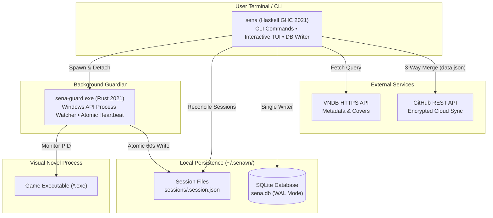

<!-- markdownlint-disable MD013 MD033 MD041 -->

<div align="center">

# SenaVN | GalKeeper 2.0

**A terminal-first Visual Novel library manager, gameplay tracker, and GitHub cloud synchronizer.**

t is designed for programmers and geeks who play visual novel games. They prefer staying in the terminal without running bulky Electron or heavy GUI managers in the background.

[](LICENSE)
[](https://github.com/biyuehu/vn-cli/actions/workflows/ci.yml)


</div>

---

## Architecture

SenaVN operates as two cooperative binaries without FFI complexity:



- **`sena` (Haskell)**: CLI interface, interactive Brick TUI, SQLite operations, VNDB API queries, and 3-way cloud sync.
- **`sena-guard` (Rust)**: Standalone lightweight daemon for low-level Windows process polling. Completely independent from SQLite, ensuring zero database lock contention.

---

## Features

- **Hardcore & Cool**: Pure terminal-first, keyboard-driven experience with sleek ANSI aesthetics, blazing-fast responsiveness and based functional programming Haskell!
- **Zero GUI Overhead**: Run `sena` for a full-featured interactive TUI, use concise CLI subcommands for shell scripting and aliases, and use terminal file picker without manually typing paths.
- **Seamless VNDB Integration**: Search visual novels directly by name or ID, interactively select search results, and review/edit metadata inside your preferred `$EDITOR` before saving.
- **3-Way Cloud Synchronization**: End-to-end sync with GitHub repositories based GitHub API. And decoupled local paths, only metadata is pure and cloud-synced.
- **Git-Log Style Timelines**: Visualize play history with ASCII graphs and summary statistics.
- **Native Windows Adaptation**: Automatic UTF-8 (`CP65001`) console output switching without needing manual `chcp`, with full support for ANSI styling and color themes.

---

## Tech Stack

| Component | Technologies |
| :--- | :--- |
| **CLI & TUI Engine** | Haskell (GHC 2021, Base 4.19), [Brick 2.12](https://github.com/jtdaugherty/brick), [Vty](https://github.com/jtdaugherty/vty), [optparse-applicative](https://github.com/pcapriotti/optparse-applicative) |
| **Process Guardian** | Rust 2021, `sysinfo`, `winapi` (Windows User32 / Kernel32) |
| **Database & Cache** | SQLite 3 (`sqlite-simple` with WAL journal mode, busy timeouts, and cascading foreign keys) |
| **Network & Sync** | [Req](https://github.com/mrkkrp/req) (HTTP/HTTPS client), Aeson (JSON serialization), RFC 4648 Base64 |
| **Testing & CI** | Self-contained zero-dependency Haskell test suite (51 test cases), GitHub Actions CI |

---

## Usage

Please refer to [SenaVN Document](https://vn.himeno-sena.com/).

---

## Build & Development

- **GHC 9.8.2** & **Cabal 3.10+** (via [GHCup](https://www.haskell.org/ghcup/))
- **Rust Stable** (via [rustup](https://rustup.rs/))
- **Just** task runner (optional, recommended: `cargo install just`)

```sh
# One-step build: compiles both Rust and Haskell, and syncs sena-guard.exe
just build

# Or manually:
cargo build --release
cabal build
copy target\release\sena-guard.exe (dist-newstyle\..\SenaVN.exe directory)

# Run full test suite (51 unit tests)
cabal test

# Check code formatting & compiler warnings
cargo clippy --all-targets -- -D warnings
cabal build --enable-tests --ghc-options="-Werror"
```

---

## About

`Sena` is named after **姬野星奏 (Himeno Sena)**, the heroine from the visual novel [*恋×シンアイ彼女 (Koi x Shin Ai Kanojo)*](https://vndb.org/v17516).

---

## License

This project is licensed under the **GNU General Public License v3.0** — see the [LICENSE](LICENSE) file for details.
